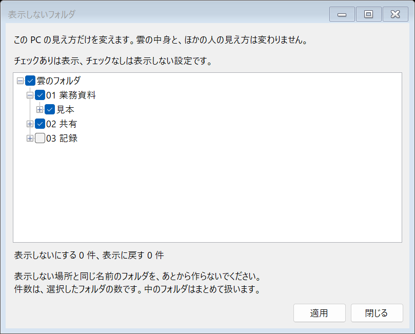

# DbxLight

Windows で Dropbox を軽く使うための、小さな常駐アプリです。
Dropbox のフォルダをドライブ (たとえば `T:`) としてエクスプローラーに出します。一覧はいつも雲の側の物を見せ、ファイルは開いたときだけ落とし、使い終わった物は時間がたつと手元から消します。

ファイルのやり取りと手元のキャッシュは [rclone](https://rclone.org/) と [WinFsp](https://winfsp.dev/) に任せています。DbxLight が受け持つのは、その外側 (常駐、設定の窓、表示しないフォルダ、状態の表示、右クリック、コマンド) と、止まったときに上げ残した物を、次の起動のときに雲の側と照らして、上げるか取り出すかを決める所です。

Dropbox 社の製品ではありません。公式の Dropbox アプリの代わりに、自分の責任で使う道具です。


## どのくらい軽いか

同じ PC で、公式の Dropbox アプリと並べて動かして測りました。

| | プロセス | メモリ (Private の合計) |
| --- | --- | --- |
| 公式の Dropbox アプリ | 7 本 | 1,706 MB |
| DbxLight (常駐 + rclone + 小さい補助) | 3 本 | 104 MB |

- 測った日と環境: 2026-11-14、Windows 11、チームで使っているファイルの多い Dropbox。DbxLight は読み取り専用でつないで、起動から 30 分後に測りました
- DbxLight の内訳は、常駐 34 MB、rclone 69 MB、補助 (コンソールのホスト) 1 MB です。表の数字は、いちばん上と、その下のフォルダ 1 つの一覧を読んだだけの状態です。広い範囲の一覧を読むと、一覧のキャッシュが 1 時間ぶん rclone に載るので、合計が増えます (開発の途中の版での実測では、読む前の 92 MB が、読んだあとに最大 130 MB になりました)
- 公式のアプリのメモリは、同期しているファイルの数で変わります。上の数字は 1 台の PC での実測で、どの環境でも同じ比になるという意味ではありません
- 測り方: `Get-Process` の `PrivateMemorySize64` を、プロセスの名前ごとに合計

## できること

- **エクスプローラーにドライブとして出る**。フォルダの一覧は雲の側の物で、雲の変更は 1 分おきに取り込みます
- **開いたときだけ落とす**。開いた (中身を読んだ) ファイルだけが手元に来ます。中身を読む道具が触れたファイルも落ちます (下の「知っておくこと」の「広い範囲を読む道具」)
- **落としたファイルを自動で消す**。最後に使ってからの時間を、30 分・1 時間・3 時間・1 日・1 週間から選べます。上げ終わっていないファイルは消しません
- **表示しないフォルダを選べる**。エクスプローラーの右クリックの「このフォルダを表示しない」か、トレイのメニューの「表示しないフォルダ」で開く窓で選びます。この PC での見え方だけが変わり、雲の中身とほかの人の見え方は変わりません
- **ブラウザからログイン**。はじめての設定の窓で「Dropbox にログイン」を押すと、いつものブラウザで Dropbox の認可の画面が開きます
- **既定は読み取り専用**。書き込みは、設定の窓のスイッチで、確認を経てから入れます
- **状態が見える**。上げ待ちの件数と名前、失敗したファイルを、状態の窓で見せます。トレイのアイコンは、いまの状態 (稼働・上げている途中・注意・失敗か停止・準備中) を示します
- **Web で開く**。右クリックの「Web で開く」で、そのファイルやフォルダを Dropbox の Web の画面で開けます
- **AI の道具から使いやすい**。中身を落とさずに探す・状態を見る・保存したファイルが上がったかを確かめるコマンドがあります (下の節)

設定の窓 (読み取り専用の状態):


表示しないフォルダを選ぶ窓 (トレイのメニューの「表示しないフォルダ」から開きます):



状態の窓 (書き込みを有効にして、上げ待ちが 1 件あるときの見本):


画面の例は、どれも見本のデータで描いた物です (ドライブは `U:`、接続先の名前は `dbxlight:` や `sample-existing:` になっています)。

## 要る物

- Windows 11 (64 ビット)。Windows 10 では確かめていません
- [.NET 8 SDK](https://dotnet.microsoft.com/download/dotnet/8.0)。いまは配布用の実行ファイルを用意していないので、ソースからビルドします
- rclone。v1.74.3 だけで確かめています。版を指定して入れるなら `winget install Rclone.Rclone --version 1.74.3`
- WinFsp。2.1 で確かめています: `winget install WinFsp.WinFsp`

DbxLight は rclone と WinFsp を同梱しません。足りない物があると、はじめての設定の窓が、入れるための命令を示します (アプリが勝手に入れることはありません)。

## はじめかた

1. このリポジトリを取ってきてビルドします。

   ```powershell
   git clone https://github.com/miyafcos/DbxLight.git
   cd DbxLight
   dotnet build DbxLight.sln -c Release
   ```

   できる物は 2 つです。

   - 常駐アプリ: `src/DbxLight.Tray/bin/Release/net8.0-windows/DbxLight.exe`
   - コマンド: `src/DbxLight.Cli/bin/Release/net8.0-windows/dbxl.exe` (下の「AI の道具から使う」で使います)

2. `DbxLight.exe` を起動します。設定がまだ無いので、はじめての設定の窓 (題は「ログインと接続先」) が開きます。
3. 窓の順に進めます。
   1. 要る物の確かめ (rclone と WinFsp)
   2. 「Dropbox にログイン」。ブラウザで認可すると、次の段へ進みます
   3. 見える範囲を選ぶ (自分のフォルダか、チームの最上位か)。チームの最上位は、チーム向けの Dropbox で、チームのフォルダが並ぶいちばん上の階層です。個人の Dropbox では、自分のフォルダを選びます
   4. 割り当てるドライブ、手元に残す時間、表示しないフォルダ
   5. 読み取り専用で始める

   

4. エクスプローラーにドライブが出ます。まずは読み取り専用のまま、見え方と重さを確かめてください。
5. 書き込みを使うときは、設定の窓の「書き込みを有効にする」を入れます。確認の窓が出ます。下の「知っておくこと」を先に読んでください。

   

すでに rclone で Dropbox のリモートを作ってある人は、窓の 2 段目 (Dropbox にログイン) で「すでにある rclone のリモートを使う」を選べます。

ブラウザでログインしたときの鍵は、アプリ専用の rclone の設定ファイル (`%APPDATA%\DbxLight\credentials-<設定ごとの識別>\rclone.conf`) に入ります。本人だけが読める権限のフォルダに作り、アプリは中身を画面や記録に出しません。すでにある rclone のリモートを使うときは、鍵はその rclone の設定ファイルに入ったままで、DbxLight は書き換えません。ログインし直す・ログアウトするは、設定の窓から行います。ログインし直したあとは、読み取り専用から始まります (前のアカウントの書き込みの設定は引き継ぎません)。

## 知っておくこと

書き込みを有効にする前に、次の点を読んでください。

- **保存は少し遅れて雲に上がります**。ふつうの終了と設定の変更は、上げ待ちがあるあいだ引き止めます。Windows のログオフ・シャットダウンのときも同じ確認を通す作りですが、Windows を終了するときの引き止めは、実物では確かめていません。強制の停止や電源断で、上がりきる前に止まったときは、残りを次の起動のときに雲の側と比べてから上げます (2 つ下の項目)
- **同じファイルを 2 人が同じ時間帯に直すと、あとから保存した側で上書きになります**。公式の Dropbox アプリは「競合コピー」を作って両方を残しますが、DbxLight にはその仕組みがありません (中で使っている rclone に、その仕組みが無いためです)。ほかの人と同時に直すファイルには向きません。上書きされた側の版は、DbxLight の中には残りません。Dropbox の版の履歴 (「Web で開く」から見られます) に残っていれば、そこから戻します
- **アプリが止まっていたあいだの更新には気づきます**。上げ待ちを残したまま止まり (強制の停止、電源断など)、そのあいだにほかの人が同じファイルを更新していた場合は、起動のときに気づいて、雲の側を上書きせず、手元の版を取り出して残します。起動の直前 (30 秒以内) に雲の側が変わっていないと確かめた物だけを上げます。確かめてから上がるまでのあいだの更新は防げません。上げ残しがあるのに雲の側へ問い合わせられないとき (ネットにつながっていないなど) は、上げ残しを動かさずに、起動を断ります。つながってから起動し直してください
- **上げられなかった物は、消さずに取り出して残します。自動では上げ直しません**。止めたときの上げ残しのうち、安全に上げられると確かめられなかった物は、キャッシュの置き場の隣のフォルダ (`<キャッシュの置き場>-rescue`。設定の `rescueDir` で変えられます) に取り出します。たとえば次の物です。
  - 管理情報が壊れた物、本体と管理情報の片方が欠けた物、途中までしか書かれていない物
  - 名前を扱えない物 (下の「名前によっては」の項目)
  - 雲の側と比べられなかった物
  - ほかの人の更新とぶつかった物
  - 数が多い・遅いために、時間の上限 (30 秒以内の照らしのやり直しは 3 回まで、全体では 120 秒・200 フォルダまで) の中で比べきれなかった物

  取り出した物があると、トレイが件数を知らせます。理由と保存先は、状態の窓と `dbxl rescue list` に出ます (`dbxl status` には件数が出ます)。戻すときは、保存先を開いて、ドライブの元の場所へ自分で写してください。ほかの人の更新とぶつかった物は、両方を開いて見比べてから戻します。**途中までしか書かれていない物 (`dbxl rescue list --json` の `completeData` が false の物) は、そのまま写さないでください**。中身を確かめて、足りない所を補ってから戻します。確かめ終えた物は、`dbxl rescue acknowledge <id>` (`<id>` は `dbxl rescue list` に出る物) で確認済みにすると、一覧と知らせから下がります。確認済みでない物が残っているあいだは、取り出す場所 (`rescueDir`) を変えられません。アプリは取り出した物を消しません
- **名前によっては、上げ残しを自動で上げ直しません**。止めたときに上げ残っていた物のうち、名前 (フォルダ名を含む) に全角の記号 `：？＊｜＜＞＼＂` を含む物、末尾がピリオドや空白の物、同じフォルダに全角と半角だけが違う名前がある物などは、取り出して残す側に回します。止める前に上がり終えた物には関係しません
- **大文字と小文字だけが違う名前は、同じファイルとして扱われます**。同じフォルダに `Case-A.txt` と `case-a.txt` を保存すると、あとから保存した中身で上書きになります (Windows と Dropbox の決まりで、公式のアプリでも同じです)
- **ほかの人の更新が手元に見えるまで、最大で 1 分ほどかかります**。雲の側の変更は 1 分おきに取り込みます。取り込む前に同じファイルを保存すると、相手の版を上書きします。急ぐときは `dbxl refresh <フォルダ>` で一覧を取り直せます
- **ほかの人が更新した直後に、同じファイルを続けて開き直すと、読み込みが 1 回失敗することがあります**。手元の版が新しい版に切り替わる瞬間に当たったときです (rclone の動きです)。開き直せば新しい版が開きます。失われる物はありません
- **公式の Dropbox アプリと同時に、同じフォルダへ書かないでください**
- **読み取り専用に戻しても、前から手元に残っていた上げ待ちは送られます**。読み取り専用は「新しく保存できない」という意味で、「何も上がらない」という意味ではありません
- **止まり方を覚えています**。上げ待ちを残したまま止まったとき (強制の停止、電源断など) は「回復がまだ」と記録し、そのあいだは接続先やキャッシュの置き場を変える操作を断ります。同じ設定で起動し直して、上げ待ちが 0 になると解けます
- **閲覧だけの共有フォルダへの保存は、実物では確かめていません**。仕組みの上では、保存は手元で成功したように見えたあと、雲への上げが断られ、失敗したファイルが状態の窓に名前つきで出ます (`dbxl status` には失敗の件数、`dbxl stat <パス>` にはそのファイルの上げの状態が出ます)。閲覧だけのフォルダには保存しないでください
- **読み取り専用のときに「消す」をしても、エラーは出ず、何も起きません**。ファイルは手元にも雲にも残ります。作る・上書きする・名前を変えるは、エラーで断られます
- **オフラインで使うことは考えていません**。ネットにつながっていないと、一覧の取り直しも、落としていないファイルを開くこともできません。手元に残っているファイルがそのとき開けるかは、確かめていません。落としてあるファイルも、手元に残す時間を過ぎると消えます
- **広い範囲を読む道具に注意してください**。ウイルス対策の全体の検査、検索の索引、フォルダを丸ごと読む道具は、ファイルの中身を次々に落とします。短い間に多くのファイルを落としていると、トレイが知らせます
- **ログインの鍵は平文で保存されます** (本人だけが読める権限)。PC を共用している場合は使わないでください
- **キャッシュの置き場を既定から変えると、そのフォルダを読める人は、置いた場所の権限のままになります**。既定の置き場は、本人のアカウントの中です。取り出した物の置き場・記録・状態のフォルダは、本人だけが読める権限で作ります。ほかの人も読める既存のフォルダを指定したときは、そこを使わずに断ります
- **起動のたびに、rclone の記録に ERROR の行が 1 行出ます** (シンボリックリンクに対応していない、という趣旨の行です)。動きへの影響は見つかっていません
- **同じ PC で DbxLight を 2 つ以上 (別の設定で) 動かすと、片方の起動・停止のあいだ、もう片方のコマンドが数秒 `busy` を返します**。`busy` は「確かめられなかった」という意味で、成功でも失敗でもありません。数秒おいて同じコマンドを呼び直すと、その時点の状態が返ります。ほかの設定の操作が長引いても、動いている割り当ては止めません (見張りが遅れるだけです)。起動・停止・設定の変更などの操作の側は、順番待ちが 45 秒を超えると、その操作が失敗として終わります (起動の途中だったときは、メニューの「再開」で戻ります)。ほかの操作が順番待ちを握り続けているあいだは、止める操作と自動のつなぎ直しも待たされます
- **Dropbox の API には、チーム単位の上限があります**。大量に書き込む使い方は、管理者に確かめてからにしてください

## できないこと

- エクスプローラーの状態のアイコン (同期済みの印) と、Dropbox の右クリックの項目 (共有リンクの作成、版の履歴)。版の履歴は「Web で開く」から見られます
- オフラインでの利用
- Windows 以外の OS (macOS、Linux)

## AI の道具 (Claude Code など) から使う

コマンド `dbxl` に、AI の道具が安全に使うための入口があります。

- `dbxl.exe` は、ビルドすると `src/DbxLight.Cli/bin/Release/net8.0-windows/` にできます。このフォルダを PATH に入れるか、完全なパスで呼びます
- 設定の場所は、`--config`、環境変数 `DBXL_CONFIG`、`%APPDATA%\DbxLight\config.json` の順に探します (状態は `--state`、`DBXL_STATE`、`%LOCALAPPDATA%\DbxLight\state.json` の順)。常駐アプリを既定の設定で使っていれば、何も付けずに呼べます
- どのコマンドも、`--json` を付けると、成功でも失敗でも JSON を 1 つ返します

| コマンド | すること |
| --- | --- |
| `dbxl status` | 動いているか、上げ待ちと失敗の件数、回復の状態 |
| `dbxl ls <パス>` | 中身を落とさずに一覧 (名前・大きさ・時刻・手元にあるか) |
| `dbxl find <語> --in <パス>` | 中身を読まず、名前から探す。広い範囲は時間の上限で途中までを返し、続きから呼べる |
| `dbxl stat <パス>` | 1 件の情報と、上げの状態 |
| `dbxl wait <パス>` | 保存して閉じたファイルが雲に上がるまで待つ (ファイルを閉じてから呼びます)。その大きさと時刻の版を雲の側で確かめられたときだけ終了値 0 (中身の一致までは確かめません) |
| `dbxl rescue list` | 上げられずに取り出して残した物のうち、確認済みでない物の一覧 (既定は新しい 50 件。`--all` で確認済みでない物の全部) |
| `dbxl rescue acknowledge <id>` | 取り出した物を 1 件、確認済みにして一覧から下げる (`<id>` は `rescue list` に出る物。取り出した物そのものは消しません) |
| `dbxl refresh <フォルダ>` | 一覧を取り直す |
| `dbxl resolve <パスか URL>` | 手元のパス・雲の相対パス・Web の URL を引き合う |
| `dbxl agent-guide` | いまの設定に合わせた、AI の道具向けの手引きを出す |

- `status` は、終了値だけで判断しません。JSON の `ok`・`running`・`ready`・`recoveryRequired`・`processUncertain`・`statusError` を読みます。null は「分からない」という意味で、0 や「問題なし」ではありません
- 終了値 3 は「まだ」です。`code` が `busy` (別の DbxLight の操作の順番待ち) なら、何も確かめられていません (その直前に見えていた失敗や上げ待ちも、答えには入りません)。数秒おいて同じコマンドを呼び直します。`status --json` の `busy` は、終了値 0 です。`ok=false`・`code=busy`・`message` (説明の文) が入り、状態の項目 (`running` など) は全部 null になります
- `recovery_required` でも、`running=true` かつ `processUncertain=false` のあいだは、前の停止からの上げ残しを確かめている最中で、確かめ終わると自動で解けます (上がらずに取り出される物もあります。長く続くときは人に知らせます)
- 止める・つなぎ直す・設定を変える・強制の操作・回復の解除は、AI の道具が人の指示なしに行わない決まりです (手引きとひな形にも書いてあります)
- `dbxl agent-guide` の出力を、道具の指示のファイル (`CLAUDE.md` や `AGENTS.md`) に貼ると、「フォルダを丸ごと読まない」「保存のあとは `wait` の 0 を確かめる」といった使い方が伝わります
- Claude Code の skill のひな形が `integrations/claude-code/SKILL.md` に、`AGENTS.md` 向けの文が `integrations/AGENTS.snippet.md` にあります
- 全コマンドと終了値は [docs/cli.md](docs/cli.md) にあります

## 設定

設定は `%APPDATA%\DbxLight\config.json` に入ります。ふだんは設定の窓から変えます。

| 項目 | 既定 | 意味 |
| --- | --- | --- |
| `remote` | なし (はじめての設定の窓で決まる) | 雲の接続先。rclone のリモート (例 `dbxlight:`。`名前:フォルダ` の形で、その下だけを割り当てることもできる) |
| `mountPoint` | `T:` | 割り当てるドライブ |
| `retention` | `1h` | 落としたファイルを手元に残す時間 (`30m` / `1h` / `3h` / `1d` / `1w`) |
| `cacheDir` | `%LOCALAPPDATA%\DbxLight\cache` | 落としたファイルを置く場所 (キャッシュの置き場) |
| `cacheMaxSize` | `5G` | 手元に置く量の上限 |
| `cacheMinFreeSpace` | `20G` | ディスクの空きがこれを下回ると、古い物から消す |
| `hiddenPaths` | なし | 表示しないフォルダ |
| `excludePatterns` | なし | 一覧から外す名前の型 |
| `writeAllowedRemotes` | なし | 書き込みを許す接続先。`remote` と完全に一致したときだけ、読み取り専用が外れる |
| `pollInterval` | `1m` | 雲の変更を取り込む間隔 |
| `dirCacheTime` | `1h` | 一覧を手元で覚えておく時間 |
| `rescueDir` | 環境変数 `DBXL_RESCUE_DIR`。それも無ければ、キャッシュの置き場の隣 (`<キャッシュの置き場>-rescue`) | 上げられなかった物を取り出して残す場所 |
| `logDir` | `%LOCALAPPDATA%\DbxLight\logs` | rclone の記録を置く場所。設定ごとのフォルダに `mount.log` を作り、10MB ごとに回して 5 本・30 日ぶんまで残す (本人だけが読める権限) |
| `rclonePath` | winget で入れた v1.74.3 の場所。無ければ PATH の `rclone.exe` | 使う rclone |
| `rcloneConfigPath` | なし (rclone の既定の設定ファイル) | rclone の設定ファイルの場所。ブラウザでログインすると、アプリ専用の設定ファイルの場所が入る。すでにある rclone のリモートを使うときは、なしのまま |
| `networkMode` | `true` | ネットワーク ドライブとして割り当てる |
| `rcPort` | `5601` | rclone を操作するためのポート (この PC の中 `127.0.0.1` だけで開く) |
| `downloadWindowSeconds` / `downloadFileThreshold` / `downloadByteThreshold` | `300` / `100` / `2000000000` | この秒数のあいだに落とした物が、この件数かこのバイト数以上になったら、トレイが知らせる |

このほかに、試験のための `testOverrides` があります (ふだんは使いません)。

## 開発

```powershell
dotnet build DbxLight.sln -c Release
dotnet run --project tests/DbxLight.Tests -c Release --no-build -- --all
```

- C# / .NET 8 (WinForms)。外部のパッケージは使っていません
- 試験は、手元のフォルダを接続先にして rclone を実際に動かします。Dropbox にはつなぎません。rclone と WinFsp が要ります。空いているドライブ文字をいくつか使います (U: V: W: など)
- 試験は、動いている DbxLight と同じ順番待ちを使います。常駐を動かしたまま走らせると、常駐のコマンドが `busy` を返したり、起動が遅れたりすることがあります
- 設計の判断は `docs/adr/` にあります

## ライセンスと商標

DbxLight は [MIT ライセンス](LICENSE) で公開しています。無保証です。大事なファイルで書き込みを使う前に、上の「知っておくこと」を読み、見本のフォルダで動きを確かめてください。

Dropbox は Dropbox, Inc. の商標です。DbxLight は Dropbox, Inc. と関係のない、非公式の道具です。
rclone と WinFsp は、それぞれのプロジェクトの物で、それぞれのライセンスに従います。
