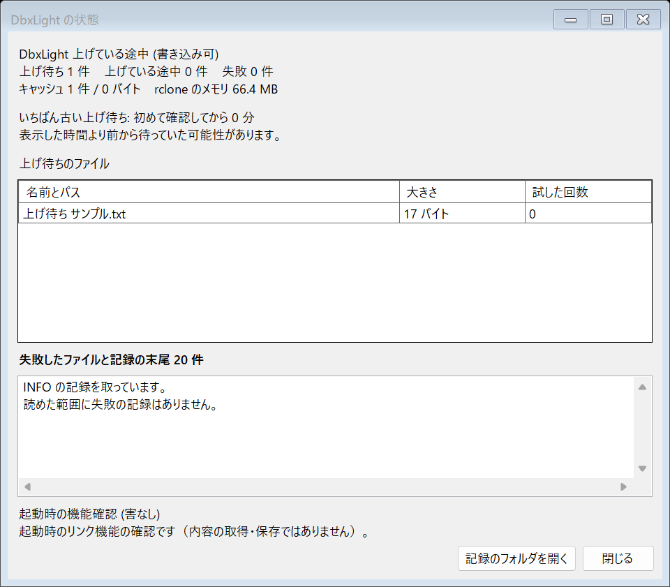
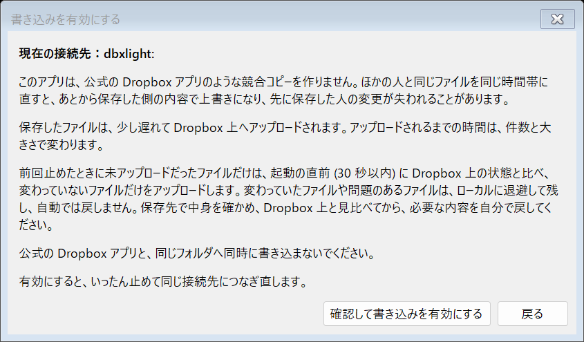
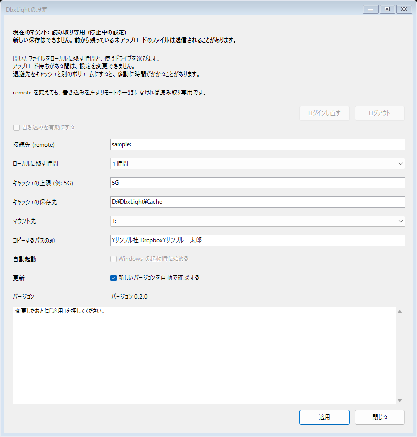
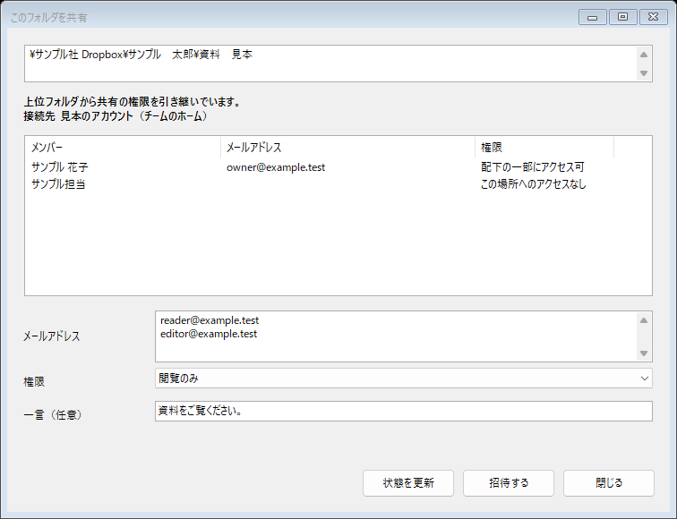
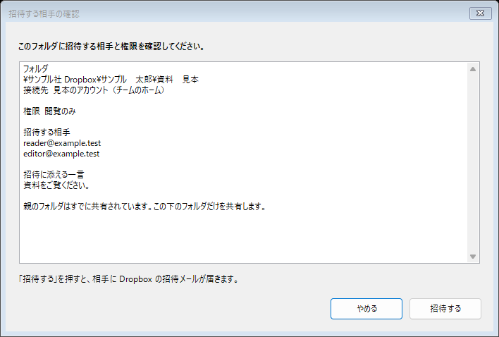

# DbxLight

Windows で Dropbox を軽く使うための、小さなタスクトレイ常駐アプリです。
Dropbox のフォルダを、エクスプローラーにドライブ (たとえば `T:`) として表示します (この README では「マウント」と呼びます)。フォルダ一覧には常に Dropbox 上の状態を表示し、ファイルは開いたときだけダウンロードして、使い終わったファイルは一定時間がたつとローカルから自動で削除します。

ファイルの通信とローカルのキャッシュ管理は [rclone](https://rclone.org/) と [WinFsp](https://winfsp.dev/) に任せています。DbxLight が担当するのは、その外側の仕組み (タスクトレイ常駐、設定画面、表示しないフォルダの切り替え、状態の表示、右クリックメニュー、CLI コマンド) と、停止時に未アップロードのまま残ったファイルを次回起動時に Dropbox 上の状態と照合し、アップロードするか退避するかを判断する処理です。

本ソフトは Dropbox 社の製品ではありません。公式の Dropbox アプリの代わりに、ご自身の責任で使う非公式ツールです。


## どのくらい軽いか

同じ PC で、公式の Dropbox アプリと同時に動かして測定しました。

| | プロセス | メモリ (Private の合計) |
| --- | --- | --- |
| 公式の Dropbox アプリ | 7 本 | 1,706 MB |
| DbxLight (常駐 + rclone + 補助プロセス) | 3 本 | 104 MB |

- **測定日と環境**: 2026-11-14、Windows 11、チームで使っているファイル数の多い Dropbox。DbxLight は読み取り専用で接続し、起動から 30 分後に測定しました。
- **DbxLight の内訳**: 常駐アプリ 34 MB、rclone 69 MB、補助プロセス (コンソールホスト) 1 MB です。表の数値は、最上位フォルダとその直下のフォルダ 1 つだけの一覧を読み込んだ状態です。広い範囲のフォルダ一覧を読み込むと、一覧のキャッシュが 1 時間分 rclone に保持されるため合計が増えます (実測では、約 1 万 2 千個のフォルダの一覧を続けて読み込んだ直後に、rclone が 69 MB から 259 MB になりました。このときの合計は 294 MB で、公式アプリの約 6 分の 1 です)。
- **環境による違い**: 公式アプリのメモリ使用量は、同期しているファイル数によって変わります。上の数値は 1 台の PC での実測値であり、どの環境でも同じ比率になるという意味ではありません。
- **測定方法**: `Get-Process` の `PrivateMemorySize64` をプロセス名ごとに合計しました。

## できること

- **エクスプローラーにドライブとしてマウント**: フォルダ一覧には Dropbox 上の内容を表示し、Dropbox 上の変更は 1 分おきに反映します。
- **開いたときだけダウンロード**: 開いた (中身を読み込んだ) ファイルだけがローカルにダウンロードされます。ファイルの中身を読み取るツールがアクセスしたファイルもダウンロードされます (下の「知っておくこと」の「広範囲のファイルを読み取るツール」を参照)。
- **ダウンロードしたファイルを自動削除**: 最後に使ってからの保持時間を、30 分・1 時間・3 時間・1 日・1 週間から選べます。アップロードが完了していないファイルは削除しません。
- **表示しないフォルダを選択**: エクスプローラーの右クリックメニュー「このフォルダを表示しない」、またはトレイメニューの「表示しないフォルダ」から開く画面で選べます。この PC での見え方だけが変わり、Dropbox 上のファイルや他の人の見え方は変わりません。
- **ブラウザからログイン**: 初回セットアップ画面で「Dropbox にログイン」を押すと、普段使っているブラウザで Dropbox の認可画面が開きます。
- **既定は読み取り専用**: 書き込みは、設定画面のスイッチを切り替え、確認ダイアログを経てから有効にします。
- **状態が見える**: アップロード待ちの件数とファイル名、失敗したファイルを状態画面で確認できます。トレイアイコンは現在の状態 (稼働・アップロード中・ダウンロード中・注意・失敗または停止・準備中) を示します。
- **ダウンロードの進み具合が見える**: 大きなファイルを開いて Dropbox から落としているあいだは、トレイアイコンにマウスを載せると「ダウンロード中: 見本.pdf 21 / 32 MB」のように表示されます。状態画面には、ファイルごとの済んだ量と残りの見込みが出ます。時間のかかる大きなファイルのときだけ、ファイル名を添えた通知を 1 回出します。ダウンロードが始まってから表示されるまで、最大で 30 秒ほどかかることがあります。
- **Web で開く**: 右クリックメニューの「Web で開く」から、そのファイルやフォルダを Dropbox の Web 画面で開けます。
- **パスをコピー**: 右クリックメニューの「パスをコピー」で、公式 Dropbox アプリを使っている人にも通じる形のパスをコピーできます。Slack などで保存場所を伝えるときに使えます (下の「パスのコピーとフォルダの共有」を参照)。
- **Web のリンクをコピー**: 右クリックメニューの「Web のリンクをコピー」で、「Web で開く」と同じ Dropbox の URL をコピーできます。
- **フォルダを共有**: フォルダの右クリックメニュー「このフォルダを共有…」から、メールアドレスを指定して Dropbox の招待を送れます。送る前に、宛先と権限を確認する画面が出ます。
- **AI ツールから使いやすい**: ファイルの中身をダウンロードせずに検索する、状態を確認する、保存したファイルがアップロードされたかを確認する CLI コマンドがあります (後述)。
- **新しいバージョンの確認と更新**: 1 日に 1 回、新しいバージョンが出ていないかを確認して知らせます。トレイメニューから、確認ダイアログを経て更新できます (下の「アップデート」を参照)。

設定画面 (読み取り専用の状態):


表示しないフォルダを選ぶ画面 (トレイメニューの「表示しないフォルダ」から開きます):


状態画面 (書き込みを有効にして、アップロード待ちが 1 件あるときの表示例):



画面のスクリーンショットはすべてサンプルデータで作成した表示例です (ドライブは `U:`、接続先のリモート名は `dbxlight:` や `sample-existing:` になっています)。

この README の「状態画面」はトレイメニューの「状態を見る」、「設定画面」は「設定」で開く画面です。「初回セットアップ画面」は、アプリでは「ログインと接続先」という題の画面です。

## 必要な環境

- **Windows 11 (64 ビット)**: Windows 10 では確かめていません。
- **[.NET 8 デスクトップ ランタイム](https://dotnet.microsoft.com/download/dotnet/8.0)**: 配布用の zip には同梱していません (`winget install Microsoft.DotNet.DesktopRuntime.8`)。ソースからビルドするときは .NET 8 SDK を使います。
- **rclone**: v1.74.3 だけで確かめています。バージョンを指定してインストールするなら `winget install Rclone.Rclone --version 1.74.3` を実行します。
- **WinFsp**: 2.1 で確かめています (`winget install WinFsp.WinFsp`)。

DbxLight は rclone と WinFsp を同梱しません。不足しているツールがあると、初回セットアップ画面がインストール用のコマンドを表示します (アプリが勝手にインストールすることはありません)。

## はじめかた

1. [Releases](https://github.com/miyafcos/DbxLight/releases) から `DbxLight-<バージョン>-win-x64.zip` をダウンロードし、自分のアカウントで書き込めるフォルダ (たとえば `%LOCALAPPDATA%\Programs\DbxLight`) に展開します。

   展開すると、次の 2 つの実行ファイルが同じフォルダにできます。

   - 常駐アプリ: `DbxLight.exe`
   - CLI コマンド: `dbxl.exe` (下の「AI ツール (Claude Code など) から使う」で使用します)

   展開するときの注意は次のとおりです。

   - **zip の確認**: Releases には zip と同じ名前の `.sha256` ファイルも置いてあります。`Get-FileHash <zip> -Algorithm SHA256` の結果と比べると、ダウンロードした zip が壊れていないかを確かめられます。
   - **署名はありません**: 実行ファイルに署名を付けていないため、初回の起動時に Windows が確認の画面を出すことがあります。
   - **置き場所**: `C:\Program Files` のように管理者の権限が要る場所に置くと、アプリからの更新 (下の「アップデート」) が使えません。
   - **ソースからビルドする場合**: 下の「開発」を参照してください。

2. `DbxLight.exe` を起動します。まだ設定が無いため、初回セットアップ画面 (タイトルは「ログインと接続先」) が開きます。
3. 画面の順に進めます。
   1. 必要なツールの確認 (rclone と WinFsp)
   2. 「Dropbox にログイン」: ブラウザで認可すると、次のステップへ進みます。
   3. 表示する範囲の選択 (自分のフォルダか、チームの最上位階層か): チームの最上位階層とは、チーム向け Dropbox でチームフォルダが並ぶいちばん上の階層です。個人の Dropbox では自分のフォルダを選びます。
   4. マウントするドライブ、ローカルにキャッシュを残す時間、表示しないフォルダの設定
   5. 読み取り専用で開始

   

4. エクスプローラーにドライブが表示されます。まずは読み取り専用のまま、フォルダの見え方や動作の軽さを確かめてください。
5. 書き込みを使うときは、設定画面の「書き込みを有効にする」をオンにします。確認ダイアログが出ますので、下の「知っておくこと」を先に読んでください。

   

- **既存の rclone リモートを使う場合**: すでに rclone で Dropbox のリモートを作成してある場合は、初回セットアップ画面のステップ 2 (Dropbox にログイン) で「すでにある rclone のリモートを使う」を選べます。
- **認証情報の保存先と再ログイン**: ブラウザでログインしたときの認証情報は、アプリ専用の rclone 設定ファイル (`%APPDATA%\DbxLight\credentials-<設定ごとの識別>\rclone.conf`) に保存されます。本人だけが読める権限のフォルダに作成され、アプリが中身を画面やログに出すことはありません。既存の rclone リモートを使う場合は、認証情報はその rclone 設定ファイルに入ったままで、DbxLight は書き換えません。再ログインやログアウトは設定画面から行います。再ログインした後は、読み取り専用から始まります (前のアカウントの書き込み設定は引き継ぎません)。

## アップデート

- **確認**: 起動の 2 分後と、そのあと 24 時間ごとに、このリポジトリの Releases に新しいバージョンが出ていないかを確認します。見つかると、タスクトレイが 1 つのバージョンにつき 1 回だけ知らせます。トレイメニューの「更新を確認」で、いつでも手動で確認できます。
- **更新**: 新しいバージョンがあると、トレイメニューに「バージョン ○ に更新」が出ます。選ぶと確認ダイアログが出て、「更新する」を押すと、マウントの停止、ファイルの入れ替え、新しいバージョンでの起動の順に進みます。マウントがきれいに停止したと確かめられないときは、入れ替えを始めず、停止したままにして知らせます。操作なしにアプリが勝手に入れ替えることはありません。
- **アップロード待ちがあるとき**: 通常の終了と同じ扱いで、アップロードが終わるまで待ってから更新します。待ちを取り消すと、更新も取り消されます。
- **検証**: ダウンロードした zip は、Releases に置かれた SHA-256 と、zip の中のファイル一覧 (`release.json`) の両方と照合します。一致しなければ何も入れ替えません。
- **失敗したとき**: 入れ替えの途中で失敗すると、前のバージョンのファイルに戻して起動し直します。前のバージョンのファイルは、展開先の `backup` フォルダに新しい順で 2 つまで残ります。
- **前のバージョンに戻す**: 常駐アプリを終了してから、手元に保管した zip を指定して `dbxl update apply --from <zip> --yes` を実行します。
- **送信する情報**: 確認のときに GitHub へ送るのは、匿名の問い合わせだけです (アプリの名前とバージョンが User-Agent に入ります)。Dropbox のアカウントやファイルの情報は送りません。
- **自動の確認を止める**: 設定画面の「新しいバージョンを自動で確認する」をオフにします (設定ファイルでは `updateCheck`)。
- **使える条件**: アプリからの更新は、配布用の zip を展開して使っている場合だけ使えます。ソースからビルドした実行ファイルでは、確認まではできますが、入れ替えは行いません。rclone と WinFsp は更新しません。
- **検証の限界**: SHA-256 の照合は、ダウンロード中の破損や差し替えを検出するためのものです。実行ファイルには署名が無く、配布元そのものが書き換えられた場合は検出できません。

## パスのコピーとフォルダの共有

### パスをコピーする

ファイルやフォルダを右クリックして「パスをコピー」を選ぶと、たとえば次の形でクリップボードに入ります。複数選んだときは 1 項目につき 1 行です。

```text
\サンプル社 Dropbox\サンプル 太郎\サンプル資料\見本.pdf
```

公式 Dropbox アプリのフォルダの中で見える形と同じなので、公式アプリを使っている人にも保存場所が伝わります。rclone の既定のアプリで接続した個人アカウントでは `\Dropbox` から始まります。

パスの頭 (上の例の `\サンプル社 Dropbox\サンプル 太郎`) は、Dropbox に問い合わせて自動で決めます。自動で決められないときは、設定画面の「コピーするパスの頭」に、公式アプリで見える頭を入力してください。空欄にすると自動に戻ります。



「Web のリンクをコピー」は、「Web で開く」と同じ Dropbox の Web 上の場所の URL をコピーします。開けるのは、その場所へのアクセス権を持つ人だけです。

### フォルダを共有する

エクスプローラーでフォルダを右クリックして「このフォルダを共有…」を選ぶと、そのフォルダの共有の状況とメンバーの権限が表示されます。招待する相手のメールアドレスと、「閲覧のみ」か「編集できる」を指定します。招待に一言添えることもできます。



「招待する」を押すと、フォルダのパス・接続先・宛先・権限を確認する画面が出ます。この画面の既定のボタンは「やめる」です。確認画面で「招待する」を押したときに初めて、相手に Dropbox の招待メールが届きます。ドライブを読み取り専用にしていても招待できます。



- 親のフォルダがすでに共有されているときは、選んだフォルダだけを共有できるかを Dropbox に確認します。チームの設定や、共有フォルダの入れ子の制限によっては、Dropbox が断ります。
- 0.1.0 で起動したままのドライブでは、パスのコピーと招待は使えません。0.2.0 は起動したときの Dropbox の口座を記録して、選んだフォルダと照合するためです。0.2.0 で起動し直すと使えます (トレイメニューからの更新は、新しいバージョンで起動し直します)。
- 0.1.0 から更新したときは、右クリックの新しい項目 (パスをコピー・Web のリンクをコピー・このフォルダを共有…) を登録し直す必要があります。設定画面に表示される登録のコマンドで登録し直せます。
- 起動した直後は、Dropbox の変更の履歴を読み終えるまで、招待が「共有の状態が変わった」として止まることがあります。少し待ってからやり直してください。
- 必要な権限が足りないと表示されたら、設定画面の「ログインし直す」から Dropbox を再認可してください。

CLI からも同じことができます。招待は、まず送らずに内容を確認し (プレビュー)、表示された確認値を付けて呼び直したときだけ送ります。

```powershell
dbxl path "X:\サンプル資料\見本.pdf" --json
dbxl share show "X:\サンプル資料" --json
$preview = dbxl share invite "X:\サンプル資料" --to reader@example.test --access viewer --json | ConvertFrom-Json
$preview.result
dbxl share invite "X:\サンプル資料" --to reader@example.test --access viewer --execute --confirm $preview.result.confirmation
```

確認したあとに対象のフォルダ・共有の状態・マウントが変わると、招待は止まります。詳しくは [docs/cli.md](docs/cli.md#パスとフォルダ共有) を参照してください。

## 知っておくこと

書き込みを有効にする前に、次の点を確認してください。

### データの保存と未アップロードファイルの退避

- **保存したファイルは少し遅れて Dropbox 上へアップロードされます**。通常の終了や設定の変更は、アップロード待ちがあるあいだ引き止められます。Windows のログオフ・シャットダウン時も同じ確認を通す作りですが、Windows 終了時の引き止めは実機では確かめていません。強制終了や電源断でアップロード完了前に止まったときは、残りを次回起動時に Dropbox 上の状態と比べてからアップロードします (次の項目を参照)。アップロード待ちが 10 分を超えると、タスクトレイが知らせます。長く残ったアップロード待ちは、Dropbox 上の新しい版を上書きすることがあります。
- **アプリ停止中に他の人が行った更新は次回起動時に検知します**。アップロード待ちを残したまま停止 (強制終了、電源断など) し、そのあいだに他の人が同じファイルを更新していた場合は、起動時に検知して Dropbox 上を上書きせず、ローカルのファイルを別フォルダへ退避して残します。
  - 起動の直前 (30 秒以内) に Dropbox 上で変わっていないと確認できたファイルだけをアップロードします。確認してからアップロードが完了するまでのあいだの更新は防げません。
  - 未アップロードのファイルがあるのに Dropbox 上へ問い合わせられないとき (オフラインなど) は、未アップロードのファイルを動かさずに起動を中止します。ネットにつながってから起動し直してください。
- **アップロードできなかったファイルは削除せず退避して残し、自動では再アップロードしません**。停止時の未アップロードファイルのうち、安全にアップロードできると確認できなかったものは、キャッシュ保存先の隣のフォルダ (`<キャッシュの保存先>-rescue`。設定の `rescueDir` で変更可能) に退避します。たとえば次のようなファイルです。
  - 管理情報が壊れたもの、ファイル本体と管理情報の片方が欠けたもの、途中までしか書き込まれていないもの
  - ファイル名・フォルダ名を扱えないもの (下の「名前によっては、未アップロードのファイルを自動で再アップロードしません」の項目)
  - Dropbox 上の状態と比べられなかったもの
  - 他の人の更新と競合したもの
  - 件数が多い・処理が遅いために、制限時間 (30 秒以内の再照合は 3 回まで、全体では 120 秒・200 フォルダまで) の中で比べきれなかったもの

  退避したファイルがあると、タスクトレイが件数を知らせます。理由と保存先は、状態画面と `dbxl rescue list` に出ます (`dbxl status` には件数が出ます)。
  - 元の場所へ戻すときは、保存先を開いてドライブの元の場所へ自分でコピーしてください。他の人の更新と競合したファイルは、両方を開いて見比べてから戻します。
  - **途中までしか書き込まれていないファイル (`dbxl rescue list --json` の `completeData` が false のもの) は、そのままコピーしないでください**。中身を確認し、足りない部分を補ってから戻します。
  - 確認し終えたファイルは、`dbxl rescue acknowledge <id>` (`<id>` は `dbxl rescue list` に出る値) で確認済みにすると、一覧と通知に出なくなります (退避したファイルそのものは残ります)。未確認のファイルが残っているあいだは、退避先の場所 (`rescueDir`) を変更できません。退避したファイルを、アプリが削除することはありません。
- **前回の止まり方を記録しています**。アップロード待ちを残したまま止まったとき (強制終了、電源断など) は、回復が未完了の状態として記録し、そのあいだは接続先やキャッシュ保存先を変える操作を受け付けません。同じ設定で起動し直して、アップロード待ちが 0 件になると解除されます。
- **読み取り専用に戻しても、以前からローカルに残っていたアップロード待ちは送信されます**。読み取り専用は「新しく保存できない」という意味であり、「何もアップロードされない」という意味ではありません。

### 他の人と共有・共同編集するとき

- **同じファイルを 2 人が同じ時間帯に編集すると、後から保存した側で上書きになります**。公式の Dropbox アプリは「競合コピー」を作って両方を残しますが、DbxLight にはその仕組みがありません (内部で使っている rclone にその仕組みが無いためです)。他の人と同時に編集するファイルには向きません。上書きされた側の版は DbxLight の中には残りませんが、Dropbox のバージョン履歴 (「Web で開く」から見られます) に残っていれば、そこから戻せます。
- **他の人の更新がローカルに見えるまで、最大で 1 分ほどかかります**。Dropbox 上の変更は 1 分おきに取り込みます。取り込む前に同じファイルを保存すると、相手の版を上書きします。急ぐときは `dbxl refresh <フォルダ>` で一覧を再取得できます。
- **他の人が更新した直後に同じファイルを続けて開き直すと、読み込みが 1 回失敗することがあります**。ローカルのキャッシュが新しい版に切り替わる瞬間に当たったときに起きます (rclone の挙動です)。開き直せば新しい版が開き、失われるものはありません。
- **閲覧専用の共有フォルダへの保存は、実機では確かめていません**。仕組み上は、保存がローカルで成功したように見えたあと、Dropbox へのアップロードが拒否され、失敗したファイルが状態画面に名前つきで出ます (`dbxl status` には失敗の件数、`dbxl stat <パス>` にはそのファイルのアップロード状態が出ます)。閲覧専用のフォルダには保存しないでください。

### ファイル名と操作の制限

- **名前によっては、未アップロードのファイルを自動で再アップロードしません**。停止時に未アップロードだったファイルのうち、名前 (フォルダ名を含む) に全角の記号 `：？＊｜＜＞＼＂` を含むもの、末尾がピリオドや空白のもの、同じフォルダに全角と半角だけが違う名前があるものなどは、次回起動時に退避フォルダへ回します。停止する前にアップロードし終えたファイルには関係しません。
- **大文字と小文字だけが違う名前は、同じファイルとして扱われます**。同じフォルダに `Case-A.txt` と `case-a.txt` を保存すると、後から保存した中身で上書きになります (Windows と Dropbox の仕様で、公式アプリでも同じです)。
- **読み取り専用のときに「削除」をしても、エラーは出ず、何も起きません**。ファイルはローカルにも Dropbox 上にも残ります。新規作成・上書き・名前の変更はエラーで拒否されます。

### セキュリティとフォルダの権限

- **ログインの認証情報は平文で保存されます** (本人だけが読める権限)。PC を他の人と共用している場合は使わないでください。
- **キャッシュの保存先を既定から変えると、そのフォルダの閲覧権限は指定した場所の権限のままになります**。既定の保存先は本人のアカウントのフォルダ内です。退避先・ログ・状態のフォルダは、本人だけが読める権限で作ります。他の人も読める既存のフォルダを指定したときは、そのフォルダを使わずに拒否します。

### 動作の特徴と他のツールとの兼ね合い

- **公式の Dropbox アプリと同時に、同じフォルダへ書き込まないでください**。
- **オフラインでの利用は想定していません**。ネットにつながっていないと、一覧の再取得も、ダウンロードしていないファイルを開くこともできません。ローカルに残っているファイルがそのとき開けるかは確かめていません。ダウンロード済みのファイルも、ローカルに残す時間を過ぎると削除されます。
- **Dropbox の API にはチーム単位の上限があります**。大量に書き込む使い方は、管理者に確認してからにしてください。
- **広範囲のファイルを読み取るツールに注意してください**。ウイルス対策ソフトの全体スキャン、検索のインデックス作成、フォルダを丸ごと読み込むツールなどは、ファイルの中身を次々にダウンロードします。短時間に多くのファイルをダウンロードしていると、タスクトレイが知らせます。
- **起動のたびに、rclone のログに ERROR の行が 1 行出ます** (シンボリックリンクに対応していない、という趣旨の行です)。動作への影響は見つかっていません。
- **同じ PC で DbxLight を 2 つ以上 (別の設定で) 動かすと、片方の起動・停止のあいだ、もう片方のコマンドが数秒 `busy` を返します**。
  - `busy` は「状態を確認できなかった」という意味で、成功でも失敗でもありません。数秒おいて同じコマンドを呼び直すと、その時点の状態が返ります。
  - 他の設定の操作が長引いても、稼働中のドライブのマウントは止めません (監視が遅れるだけです)。
  - 起動・停止・設定変更などの操作側は、他の操作の完了待ちが 45 秒を超えると失敗として終わります (起動の途中だったときは、メニューの「再開」で戻ります)。他の操作が終わらないあいだは、停止操作と自動の再接続も待たされます。

## できないこと

- エクスプローラーの同期状態アイコン (同期済みの印) の表示と、公式 Dropbox の右クリックメニュー項目のうち、共有リンクの作成とバージョン履歴。どちらも「Web で開く」から Dropbox の Web 画面で操作できます (フォルダへの招待は「このフォルダを共有…」でできます)。
- オフラインでの利用
- Windows 以外の OS (macOS、Linux)

## AI ツール (Claude Code など) から使う

コマンド `dbxl` に、AI ツールが安全に操作するための機能が用意されています。

- `dbxl.exe` は、zip を展開したフォルダにあります (ソースからビルドした場合は `src/DbxLight.Cli/bin/Release/net8.0-windows/`)。このフォルダを PATH に入れるか、フルパスで呼び出します。
- 設定ファイルの場所は、`--config`、環境変数 `DBXL_CONFIG`、`%APPDATA%\DbxLight\config.json` の順に探します (状態ファイルは `--state`、`DBXL_STATE`、`%LOCALAPPDATA%\DbxLight\state.json` の順)。常駐アプリを既定の設定で使っていれば、オプションなしで呼び出せます。
- どのコマンドも、`--json` を付けると、成功でも失敗でも JSON を 1 つ返します。

| コマンド | すること |
| --- | --- |
| `dbxl status` | 稼働状態、アップロード待ちと失敗の件数、回復の状態を確認する |
| `dbxl ls <パス>` | ファイルの中身をダウンロードせずに一覧を取得する (名前・サイズ・更新日時・ローカルにあるか) |
| `dbxl find <語> --in <パス>` | ファイルの中身を読まずに名前から探す。広い範囲は制限時間で途中までを返し、続きから呼び出せる |
| `dbxl stat <パス>` | 1 件のファイル情報とアップロード状態を確認する |
| `dbxl wait <パス>` | 保存して閉じたファイルが Dropbox 上にアップロードされるまで待つ (ファイルを閉じてから呼びます)。同じサイズと更新日時の版を Dropbox 上で確認できたときだけ終了値 0 を返す (中身の一致までは確かめません) |
| `dbxl rescue list` | アップロードできずに退避したファイルのうち、未確認のものの一覧を出す (既定は新しい 50 件。`--all` で未確認のすべて) |
| `dbxl rescue acknowledge <id>` | 退避したファイルを 1 件確認済みにして一覧から下げる (`<id>` は `rescue list` に出る値。退避したファイル自体は消しません) |
| `dbxl refresh <フォルダ>` | フォルダ一覧を再取得する |
| `dbxl resolve <パスか URL>` | ローカルのパス・Dropbox 上の相対パス・Web の URL を相互に変換する |
| `dbxl path <パス>` | 右クリックの「パスをコピー」と同じ形のパスを出す |
| `dbxl share show <フォルダ>` | フォルダの共有の状況とメンバーの権限を確認する |
| `dbxl share invite <フォルダ> --to <メール> --access <viewer か editor>` | 招待の内容を確認する (送らない)。`--execute --confirm <確認値>` を付けたときだけ招待を送る |
| `dbxl agent-guide` | 現在の設定に合わせた AI ツール向けのガイドを出力する |
| `dbxl version` | 使っている DbxLight のバージョンを出す |
| `dbxl update check` | 新しいバージョンが出ているかを確認する (入れ替えは行わない) |

- **`status` の判定**: 終了値だけで判断せず、JSON の `ok`・`running`・`ready`・`recoveryRequired`・`processUncertain`・`statusError` を読みます。null は「分からない」という意味であり、0 や「問題なし」ではありません。
- **終了値 3 と `busy` の扱い**: 終了値 3 は「まだ」(完了していない・確認できていない) を示します。`code` が `busy` (別の DbxLight の操作の完了待ち) の場合は、何も確認できていません (その直前に見えていた失敗やアップロード待ちも結果には入りません)。数秒おいて同じコマンドを呼び直します。なお、`status --json` の `busy` は終了値 0 を返し、`ok=false`・`code=busy`・`message` (説明文) が入り、状態の項目 (`running` など) はすべて null になります。
- **`recovery_required` の扱い**: `recovery_required` であっても、`running=true` かつ `processUncertain=false` のあいだは前回の停止からの未アップロードファイルを確認している最中であり、確認が終わると自動で解除されます (アップロードされずに退避されるファイルもあります。長く続くときは人に知らせます)。
- **人の指示が必要な操作**: 停止・再接続・設定変更・強制操作・回復状態の解除・バージョンの更新 (`dbxl update apply`)・招待の送信 (`dbxl share invite --execute`) は、AI ツールが人の指示なしに行わない決まりです (ガイドとテンプレートにも記載しています)。
- **指示ファイルへの貼り付け**: `dbxl agent-guide` の出力を AI ツールの指示ファイル (`CLAUDE.md` や `AGENTS.md`) に貼ると、「フォルダを丸ごと読まない」「保存のあとは `wait` の終了値 0 を確かめる」といった使い方が伝わります。
- **テンプレートと詳細仕様**: Claude Code の skill のテンプレートが `integrations/claude-code/SKILL.md` に、`AGENTS.md` 向けの文面が `integrations/AGENTS.snippet.md` にあります。全コマンドと終了値の詳細は [docs/cli.md](docs/cli.md) にあります。

## 設定

設定は `%APPDATA%\DbxLight\config.json` に保存されます。普段は設定画面から変更します。

| 項目 | 既定 | 意味 |
| --- | --- | --- |
| `remote` | なし (初回セットアップ画面で決まる) | Dropbox の接続先。rclone のリモート (例: `dbxlight:`。`名前:フォルダ` の形式で、その配下だけをマウントすることも可能) |
| `mountPoint` | `T:` | マウントするドライブ文字 |
| `retention` | `1h` | ダウンロードしたファイルをローカルに残す時間 (`30m` / `1h` / `3h` / `1d` / `1w`) |
| `cacheDir` | `%LOCALAPPDATA%\DbxLight\cache` | ダウンロードしたファイルを置く場所 (キャッシュの保存先) |
| `cacheMaxSize` | `5G` | ローカルに置くキャッシュ量の上限 |
| `cacheMinFreeSpace` | `20G` | ディスクの空き容量がこれを下回ると、古いキャッシュから削除する |
| `hiddenPaths` | なし | 表示しないフォルダ |
| `excludePatterns` | なし | 一覧から除外する名前のパターン |
| `writeAllowedRemotes` | なし | 書き込みを許可する接続先。`remote` と完全に一致したときだけ読み取り専用が解除される |
| `pollInterval` | `1m` | Dropbox 上の変更を取り込む間隔 |
| `dirCacheTime` | `1h` | フォルダ一覧をローカルで保持する時間 |
| `rescueDir` | 環境変数 `DBXL_RESCUE_DIR`。それも無ければ、キャッシュ保存先の隣 (`<キャッシュの保存先>-rescue`) | アップロードできなかったファイルを退避して残す場所 |
| `logDir` | `%LOCALAPPDATA%\DbxLight\logs` | rclone のログを置く場所。設定ごとのフォルダに `mount.log` を作り、10MB ごとにローテーションして 5 本・30 日分まで残す (本人だけが読める権限) |
| `rclonePath` | winget でインストールした v1.74.3 の場所。無ければ PATH の `rclone.exe` | 使用する rclone の実行ファイルパス |
| `rcloneConfigPath` | なし (rclone の既定の設定ファイル) | rclone の設定ファイルの場所。ブラウザでログインすると、アプリ専用の設定ファイルの場所が入る。既存の rclone リモートを使うときは、なしのまま |
| `networkMode` | `true` | ネットワークドライブとしてマウントする |
| `rcPort` | `5601` | rclone を操作するためのポート (この PC 内の `127.0.0.1` だけで開く) |
| `downloadWindowSeconds` / `downloadFileThreshold` / `downloadByteThreshold` | `300` / `100` / `2000000000` | 指定秒数のあいだにダウンロードしたファイルが、指定件数または指定バイト数以上になったらタスクトレイで通知する |
| `updateCheck` | `true` | 新しいバージョンが出ていないかを自動で確認する (起動の 2 分後と、そのあと 24 時間ごと) |

このほかに、テスト用の `testOverrides` があります (普段は使いません)。

## 開発

```powershell
dotnet build DbxLight.sln -c Release
dotnet run --project tests/DbxLight.Tests -c Release --no-build -- --all
```

- C# / .NET 8 (WinForms) 製で、外部パッケージは使っていません。ビルドには [.NET 8 SDK](https://dotnet.microsoft.com/download/dotnet/8.0) が必要です。
- ビルドすると、常駐アプリが `src/DbxLight.Tray/bin/Release/net8.0-windows/DbxLight.exe` に、CLI コマンドが `src/DbxLight.Cli/bin/Release/net8.0-windows/dbxl.exe` にできます。ソースからビルドした実行ファイルでは、アプリからの更新 (入れ替え) は行いません。
- テストは、ローカルのフォルダを接続先にして rclone を実際に動かします (Dropbox には接続しません)。rclone と WinFsp が必要で、空いているドライブ文字をいくつか使います (U: V: W: など)。
- テストは、稼働中の DbxLight と同じ「他の操作の完了待ち」の仕組みを使います。常駐アプリを動かしたままテストを走らせると、常駐側のコマンドが `busy` を返したり、起動が遅れたりすることがあります。
- 配布用の zip は `python tools/make_release.py --source . --out <空のフォルダ>` で作ります (Python 3.12 以降。標準ライブラリだけを使い、内部で `dotnet publish` を実行します)。zip と、同じ名前の `.sha256` ファイルができます。
- 設計の判断は `docs/adr/` にあります。

## ライセンスと商標

DbxLight は [MIT ライセンス](LICENSE) で公開しています。無保証です。大事なファイルで書き込みを使う前に、上の「知っておくこと」を読み、テスト用のフォルダで動作を確かめてください。

Dropbox は Dropbox, Inc. の商標です。DbxLight は Dropbox, Inc. と関係のない、非公式のツールです。
rclone と WinFsp は、それぞれのプロジェクトのもので、それぞれのライセンスに従います。
